# 16S rRNA 扩增子测序双轨全流程复现工程 (`reproduction/16S`)

[](https://www.r-project.org/)
[](https://bioconductor.org/)
[](https://benjjneb.github.io/dada2/)
[](https://github.com/ChiLiubio/microeco)
[](https://github.com/FrederickHuangLin/ANCOMBC)
[](https://github.com/biobakery/maaslin3)
[](#5-全量复现成果与结果图全景画廊)

> **工作区定位**：严格遵循 `REPRO-A`～`REPRO-E` 生信复现审计标准与 `Bio-Repro Unified Pipeline Blueprint v1.0` 工程模板建成的端到端 **16S rRNA 扩增子双轨复现工程**。  
> **参考方法学与论文**：
> - **Track B 上游基准**：[benjjneb/dada2](https://github.com/benjjneb/dada2) MiSeq V4 SOP + Mothur `MiSeq_SOP` + HMP Mock 阳性对照 + SILVA v138.2 (`Zenodo 14169026`)
> - **Track A 下游生态与统计防线**：[`ChiLiubio/microeco`](https://github.com/ChiLiubio/microeco)（*Nature Protocols* 2025/2026, DOI: [`10.1038/s41596-025-01239-4`](https://doi.org/10.1038/s41596-025-01239-4)）、[`biobakery/maaslin3`](https://github.com/biobakery/maaslin3)（*Nature Methods* 2025/2026, DOI: [`10.1038/s41592-025-02923-9`](https://doi.org/10.1038/s41592-025-02923-9)）、[`ANCOM-BC2`](https://github.com/FrederickHuangLin/ANCOMBC) 与 [`decontam`](https://github.com/benjjneb/decontam)

---

## 目录
1. [目录结构与 Git 管控约定](#1-目录结构与-git-管控约定)
2. [上游原著流程 vs 本次双轨工程架构](#2-上游原著流程-vs-本次双轨工程架构)
3. [所用工具与软件包版本总表（实测快照）](#3-所用工具与软件包版本总表实测快照)
4. [复现过程中定位并解决的工程问题（7 项实测排坑）](#4-复现过程中定位并解决的工程问题7-项实测排坑)
5. [全量复现成果与结果图全景画廊](#5-全量复现成果与结果图全景画廊)
6. [一键复现与契约验收命令](#6-一键复现与契约验收命令)
7. [工程文档索引与后续拓展方向](#7-工程文档索引与后续拓展方向)

---

## 1. 目录结构与 Git 管控约定

```tree
reproduction/16S/
├── .gitignore                                  # 分层规则：屏蔽 FASTQ/SILVA库/RDS/日志 -> 放行 README 与轻量 PNG/TSV/JSON -> 末尾屏蔽私人笔记
├── README.md                                   # 本项目全景复现主入口导航（当前文件）
├── 01_16S扩增子可复现项目与文献清单.md           # REPRO-A/B：2025–2026 年 8 个已核验双轨 16S 候选与选型路线
├── 02_候选项目7维红灯审计.md                     # REPRO-C：本机实测基线 + 核心候选 7 维红灯排雷报告
├── config.yaml                                 # Blueprint v1.0 外置参数契约（随机种子、DADA2 截断、DAA/网络阈值）
├── ground_truth_contract.json                  # smoke / quick / full 三级自动化定量门禁契约
├── data/
│   ├── README.md                               # 数据总台账（样本分组、阳性 Mock / 阴性对照设计及体量汇总）
│   ├── raw/                                    # 只读原始输入：MiSeq_SOP (45 文件) + SILVA v138.2 (200.17 MiB)
│   │   └── README.md                           # 原始数据来源 URL、精确字节数与自动缓存契约
│   └── processed/                              # 可再生中间对象：filtered_fastq/、01_ps_miseq.rds、02_ps_miseq_rarefied.rds、smoke_16s_feature_audit.tsv
│       └── README.md                           # 检查点对象结构与“抽平 vs 未抽平”使用契约
├── envs/
│   ├── install_packages.R                      # CRAN (22) + Bioconductor 3.23 (11) 依赖检查与安装 (--dry-run)
│   ├── requirements.txt                        # 宿主机 Python 3.13.3 标准库编排零外部依赖说明
│   └── Dockerfile.qiime2_optional              # 可选 QIIME 2 / PICRUSt2 物理隔离容器参考配方
├── repro_scripts/
│   ├── run_all.py                              # 总控调度器 (--mode smoke / quick / full, --dry-run, 自动联动门禁)
│   ├── verify_outputs.py                       # 零依赖 JSON 定量验收校验器 -> verification_report.json
│   ├── 00_smoke_test.R                         # 10 秒确定性冒烟：成分闭合假阳性 vs CLR 校正 + 试剂盒污染稀释特征
│   ├── 01_dada2_fastq_to_phyloseq.R            # Track B 上游：FASTQ 质控 -> 错误模型 -> ASV -> Mock 验真 -> SILVA v138.2 -> GTR+G+I 中点定根树
│   ├── 02_decontam_and_diversity.R             # Track A-1：decontam 联合去污 + 稀释曲线 + Alpha + 四距离 PCoA + adonis2 & betadisper
│   ├── 03_daa_ancombc2_maaslin3_lefse.R        # Track A-2：未抽平属水平 ANCOM-BC2 vs MaAsLin 3 vs LEfSe vs TSS Wilcoxon 交叉验证
│   └── 04_microeco_network_and_func.R          # Track A-3：microeco 共现网络 + Zi-Pi Keystone + db-RDA + FAPROTAX + RF + 版本快照
├── repro_results/                              # 10 张发表级 PNG 图、12 份定量 TSV/TXT/JSON 摘要、environment_versions.tsv、verification_report.json
├── docs/
│   └── REPRO_E_16S双轨复现SOP与排坑复盘.md       # REPRO-E 技术 SOP：阈值数学依据、7 项排坑记录与新样本接入契约
└── logs/                                       # 各步骤独立日志 (*.log) 与真实子进程 sessionInfo.txt
```

---

## 2. 上游原著流程 vs 本次双轨工程架构

### 2.1 双轨全景流转图

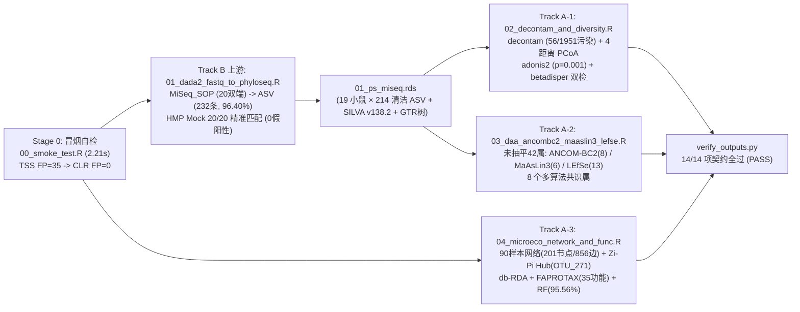

### 2.2 上游原著教程 vs 本次工程化复现对比

| 对比维度 | 上游原著交互教程 | 本次复现工程化实现 |
|---|---|---|
| **执行与路径模式** | 手动下载解压至 `~/MiSeq_SOP`，分模块在 RStudio 逐段交互执行 | `run_all.py` 一键支持 `--mode smoke / quick / full`，`01` 自动二进制缓存并校验字节数，零绝对路径硬编码 |
| **系统发育与参考库** | 原版 DADA2 SOP 使用旧版 Greengenes / SILVA v132，且未强调无根树定根 | 升级至 **SILVA v138.2**（附 Zenodo v138.1 自动兜底），显式剔除叶绿体/线粒体，并使用 `phangorn::midpoint()` 定根保障 UniFrac 确定性 |
| **统计严谨性防线** | 原教程仅展示单一 NMDS/Bray-Curtis 图与基础 `phyloseq` 绘图 | 增设三大防线：① `decontam` 联合去污验证；② 四距离（Bray / Weighted & Unweighted UniFrac / Aitchison CLR）**`adonis2` + `betadisper` 双检验**；③ 未抽平 **`ANCOM-BC2` + `MaAsLin 3` + `LEfSe` + `TSS`** 四法交叉验证 |
| **生态功能延伸** | 止步于简单属水平柱状图 | 整合 `microeco v2.4.3` 90 样本队列补齐 **Spearman 共现网络、`Zi-Pi` Keystone 识别、`db-RDA` 环境驱动、`FAPROTAX` 功能预测及随机森林生物标志物** |
| **验收与可重复性** | 无自动化定量门禁，随机种子未逐算子绑定 | `ground_truth_contract.json` + `verify_outputs.py` 自动化校验 `14/14` 项指标；`set.seed(20261125)` 紧贴每个随机算子 |

---

## 3. 所用工具与软件包版本总表（实测快照）

下表全部直接同步自真实子进程末尾导出的 [environment_versions.tsv](./repro_results/environment_versions.tsv)（运行平台：Windows + `R 4.6.0` + `Bioconductor 3.23` + `Python 3.13.3`）：

| 类别 | 软件 / R 包 | 实测版本 | 来源仓库 | 核心职能 |
|---|---|---:|---|---|
| 运行时 | `Python` / `R` | `3.13.3` / `4.6.0` | Host / Base R | 总控编排、JSON 门禁校验、核心生信计算底座 |
| 上游序列与建树 | `dada2` / `Biostrings` / `DECIPHER` / `phangorn` | `1.40.0` / `2.80.2` / `3.8.1` / `2.12.1` | Bioc 3.23 / CRAN | 质量滤波、错误率建模、ASV 降噪、SILVA 注释、多序列比对与中点定根 ML 树 |
| 生态容器与多样性 | `phyloseq` / `microbiome` / `decontam` / `vegan` / `picante` / `GUniFrac` / `ape` | `1.56.0` / `1.34.0` / `1.32.0` / `2.7.8` / `1.8.4` / `1.9` / `5.8.1` | Bioc 3.23 / CRAN | `phyloseq` 容器、联合去污、稀释抽平、Faith's PD、PCoA、`adonis2` & `betadisper` |
| 组成性差异模型 | `ANCOMBC` / `maaslin3` / `Maaslin2` / `ALDEx2` | `2.14.0` / `1.4.0` / `1.26.0` / `1.44.0` | Bioconductor 3.23 | 抽样分数偏差校正、结构零识别、丰度/流行率联合模型与对比参考 |
| 网络、功能与机器学习 | `microeco` / `file2meco` / `igraph` / `randomForest` | `2.4.3` / `0.9.1` / `2.3.4` / `4.7.1.2` | CRAN | R6 生态框架、共现网络与 `Zi-Pi` 角色、db-RDA、FAPROTAX、随机森林标志物 |
| 数据处理与可视化 | `data.table` / `ggplot2` / `patchwork` / `ggrepel` / `RColorBrewer` / `ComplexHeatmap` | `1.18.6.1` / `4.0.3` / `1.3.2` / `0.9.8` / `1.1.3` / `2.28.0` | CRAN / Bioc 3.23 | 表格清洗与出版级多联图排版 |

---

## 4. 复现过程中定位并解决的工程问题（7 项实测排坑）

| # | 阻塞现象 / 报错 | 根因诊断 | 工程解决方法与验证结果 |
|---|---|---|---|
| **1** | Windows 下 `dada2::filterAndTrim()` 开启并行极易异常 | `filterAndTrim` 内部依赖 POSIX 多进程模型，而下游 `learnErrors`/`dada`/`assignTaxonomy` 基于 `RcppParallel` 可安全多线程 | 在 [01_dada2_fastq_to_phyloseq.R](./repro_scripts/01_dada2_fastq_to_phyloseq.R) 显式设置 `multithread = !IS_WINDOWS` |
| **2** | `phangorn::optim.pml(..., rearrangement = "stochastic")` 在 214 条 ASV 上单核运行超 1,000 秒未完 | `phangorn 2.12.1` 随机棘轮启发式在 >200 枝端时搜索开销极大 | 切换为确定性 `rearrangement = "NNI"` 并配合 `phangorn::midpoint()` 定根，在 `366.28s` 内完成 `01` 全流程（含 200 MB 数据拉取） |
| **3** | `03` 初次运行 `ANCOMBC::ancombc2` 报错缺失 `microbiome` 包 | `ANCOMBC 2.14.0` 将 `microbiome` 放在 `Suggests`，但输入 `phyloseq` 时强行校验该包 | 在 [install_packages.R](./envs/install_packages.R) 补齐 `"microbiome"` 至 `bioc_core` 并安装 `microbiome 1.34.0` 后零报错通过 |
| **4** | `microeco 2.4.3` 中 `cal_spe_func` 弃用且 `tn$get_node_table()` 报错 `environment is not subsettable` | `microeco >= 1.15.1` 更名为 `cal_func`/`cal_func_FR`；R6 方法返回 `self` 并将节点表存入 `tn$res_node_table` | 迁移至 `cal_func()`/`cal_func_FR()` 并直接读取 `tn$res_node_table` |
| **5** | `04` 初版随机森林标签出现 `.10`、`.11`、`.18`、`.45` 异常空白前缀 | 空白属名 `""` 在先调用 `make.unique()` 后被编号，后续正则未能剔除数字后缀 | 改为先剔除空串及 `unclassified`/`Incertae_Sedis`，再按纯正属名 `rowsum()` 聚合后建模 |
| **6** | `03` 初版漏绘 `Butyribacter`/`Clostridium` 且 `geom_errorbarh` 报 `ggplot2 4.0.3` 弃用告警 | 二者因结构零/稀疏被 `ANCOM-BC2` 过滤导致 `LFC` 为 `NA`，原代码过滤整行误删高共识属 | 联合 `MaAsLin 3` 效应量排序保留全部 8 个共识属，在右图对过滤项标注斜体提示并改用 `geom_errorbar(orientation = "y")` |
| **7** | `00` 初版冒烟图 Panel A 文本框遮挡右上角蓝色散点 | 锚点坐标设在 `x = -0.35` 靠近真阳性散点 | 调整至左上角空白处（`x = -2.95, y = 2.75`）并重跑 `--mode smoke` 复核零遮挡 |

---

## 5. 全量复现成果与结果图全景画廊

全部产物均已通过 [verify_outputs.py](./repro_scripts/verify_outputs.py) 自动化定量验收（[verification_report.json](./repro_results/verification_report.json) 显示 **`14/14` 项 `PASS`**）。

### 5.1 阶段 0：确定性冒烟自检（[00_smoke_verification_summary.tsv](./repro_results/00_smoke_verification_summary.tsv)）
- **核心数值**：在 `24` 样本 × `40` ASV 合成队列中，单菌爆发引起的成分闭合效应导致传统 `TSS Wilcoxon` 对 `35` 个真实不变背景菌产生 **`35/35` 假阳性**；而 **CLR 中心对数比变换实现 `0/35` 背景假阳性**并精确找回全部 **`3/3` 真实差异菌**；阴性对照同步精准标记 **`2/2` 试剂盒背景污染菌**（`0` 假阳性），`Smoke_Status = PASS`（耗时 `2.21s`）。

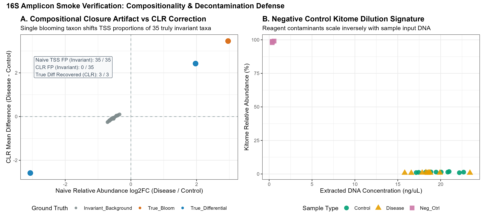

### 5.2 阶段 1：Track B 上游 DADA2 降噪、Mock 真值验真与建树（[01_mock_accuracy_summary.tsv](./repro_results/01_mock_accuracy_summary.tsv) · [01_dada2_read_tracking.tsv](./repro_results/01_dada2_read_tracking.tsv)）
- **核心数值**：`20` 对原始 V4 FASTQ 经 `truncLen = c(240, 160)` 过滤与降噪拼接生成 `293` 条序列，共识法去嵌合体后保留 **`232` 条 ASV**（全队列非嵌合读段总保留比 **`96.40%`**）；**HMP Mock 阳性对照检出 `20` 条 ASV，与参考序列实现 `20/20` 精确匹配、假阳性 `= 0`**；剔除 Mock、叶绿体、线粒体与未定门后保留 **`19` 例小鼠肠道样本 × `214` 条细菌 ASV**（SILVA v138.2 注释率：界/门/纲/目 `100%`、科 `91.1%`、属 `53.7%`、种 `4.7%`）。

<details>
<summary>点击展开查看 Track B 上游 3 张实测质控与降噪诊断图</summary>

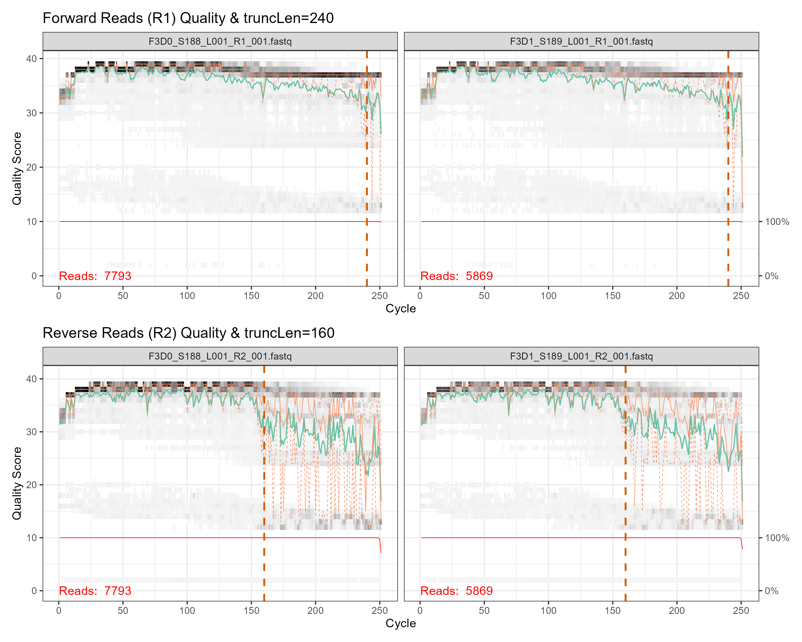
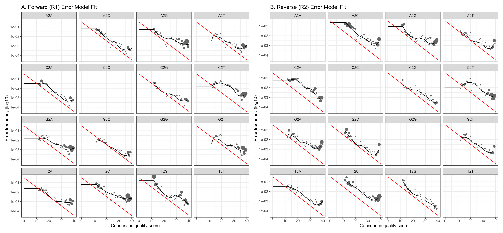
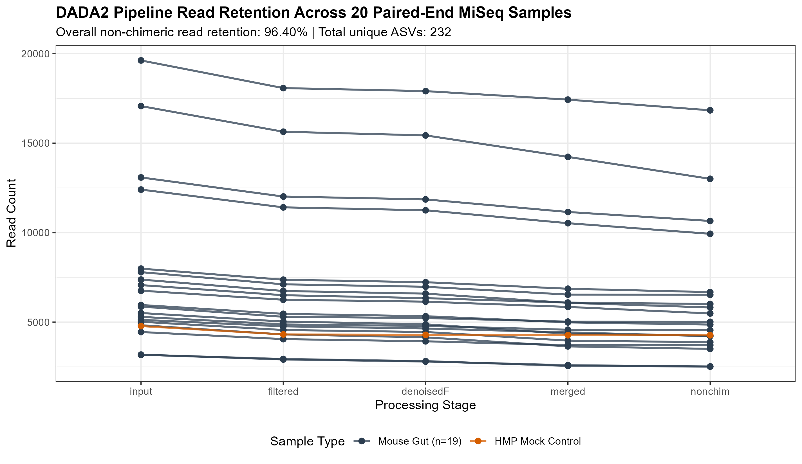

</details>

### 5.3 阶段 2：Track A-1 阴性对照去污与群落多样性防线（[02_decontam_summary.tsv](./repro_results/02_decontam_summary.tsv) · [02_diversity_stats_summary.tsv](./repro_results/02_diversity_stats_summary.tsv) · [02_permanova_betadisper_table.tsv](./repro_results/02_permanova_betadisper_table.tsv)）
- **去污染基准**：在 `decontam` `MUClite` 队列（`539` 生物样本 + `30` 阴性对照，`1,951` 特征）中识别出 **`56`** 个试剂盒污染 ASV（如 `Stenotrophomonas`、`Sphingomonas`、`Acidovorax`、`Tumebacillus`）。
- **多样性与统计防线**：按 `2,516` reads 抽平后，`Early`（`n=9`）与 `Late`（`n=10`）在 Shannon 指数（`3.6923` vs `3.3598`, `p = 0.1333`）及 Faith's PD（`p = 0.3562`）上无显著差异；但 4 种 Beta 距离的 **`PERMANOVA` 均极显著分离（`p = 0.001`）**（`Bray-Curtis R² = 0.4272`、`Weighted UniFrac R² = 0.3814`、`Unweighted UniFrac R² = 0.3594`、`Aitchison CLR R² = 0.3200`）。配套 `betadisper` 揭示 Bray-Curtis (`p = 0.008`) 存在断奶早期离散度显著高于晚期的生态收敛特征，而 **Unweighted UniFrac (`betadisper p = 0.905`)** 与 **Aitchison CLR (`betadisper p = 0.173`)** 满足方差齐性且仍极显著，排除单纯离散度假阳性。

<details>
<summary>点击展开查看 Track A-1 全部 4 张去污、组成与多样性图谱</summary>

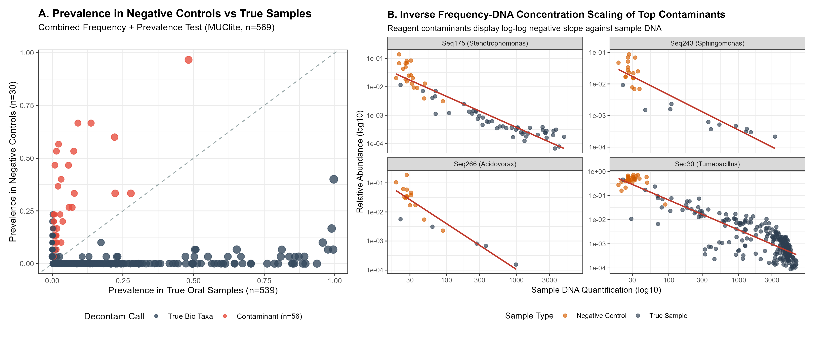
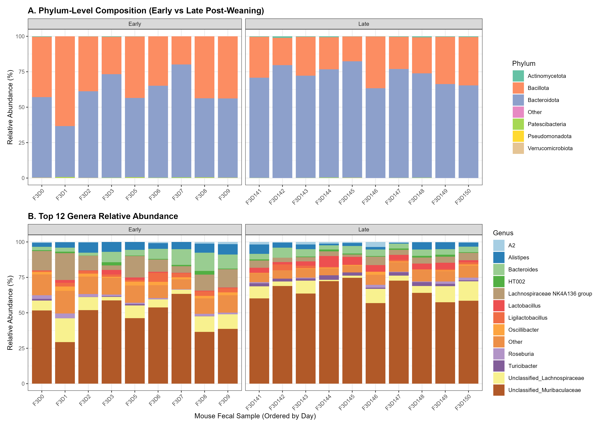
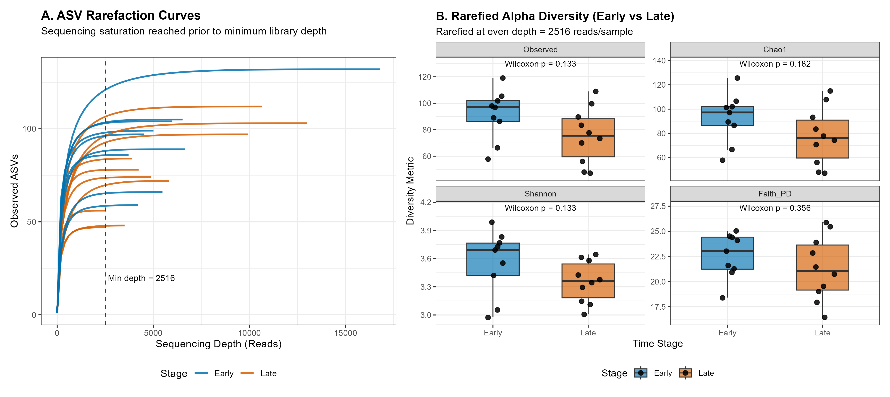
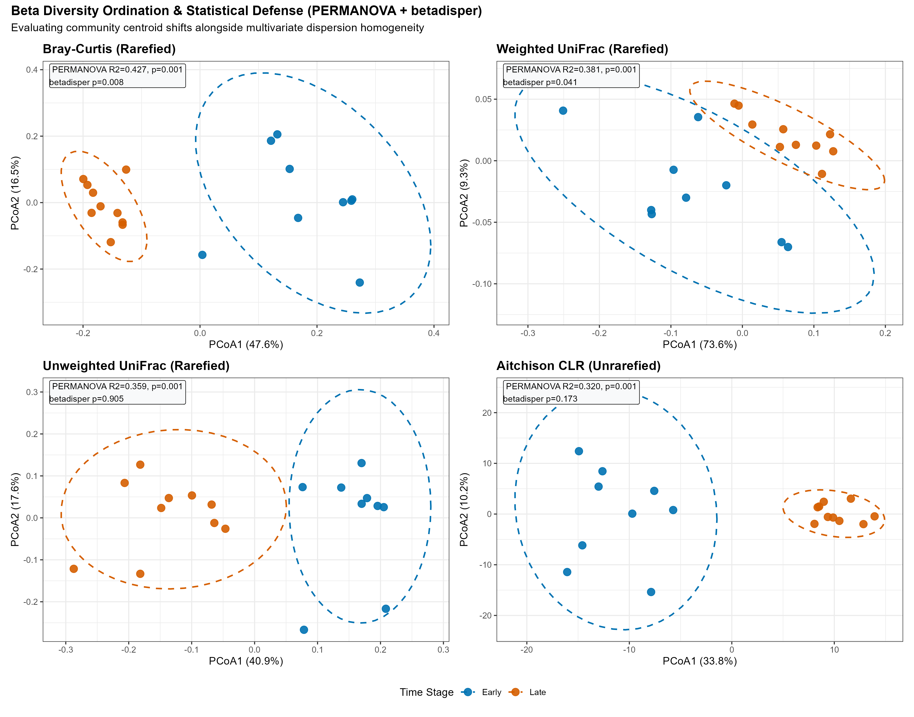

</details>

### 5.4 阶段 3：Track A-2 组成性差异丰度四方法交叉验证（[03_daa_method_comparison.tsv](./repro_results/03_daa_method_comparison.tsv) · [03_daa_consensus_genera.tsv](./repro_results/03_daa_consensus_genera.tsv)）
- **核心数值**：对未抽平属水平筛选（流行率 $\ge 10\%$）的 **`42`** 个属并行检验，**`ANCOM-BC2` 检出 `8` 属、`MaAsLin 3` 检出 `6` 属、`LEfSe` 检出 `13` 属、`TSS Wilcoxon` 检出 `13` 属**，汇总得到 **`8` 个至少获 2 种现代方法共同支持的共识差异属**（`Lactobacillus`、`Turicibacter`、`Anaerotruncus` 获全部方法一致支持于晚期显著富集）。

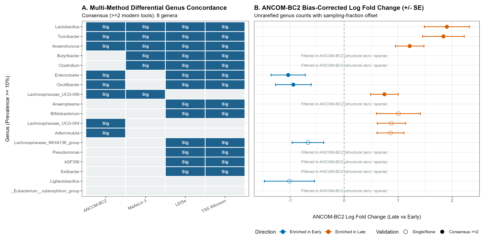

### 5.5 阶段 4：Track A-3 `microeco` 共现网络、Keystone、`db-RDA` 与机器学习（[04_microeco_summary.tsv](./repro_results/04_microeco_summary.tsv) · [04_rf_top_biomarkers.tsv](./repro_results/04_rf_top_biomarkers.tsv)）
- **核心数值**：在 `90` 样本湿地 16S 数据集（`404` ASV）上构建 Spearman 共现网络（`|r| >= 0.55, FDR < 0.01`）：包含 **`201` 节点、`856` 边、`12` 个模块**（模块度 **`0.6005`**），识别出 `1` 个 `Module hub`（`OTU_271`, *Gaiellales*）；`db-RDA`（第 1、2 轴分别解释 `32.9%` 与 `23.8%`）清晰关联海拔、pH、电导率、降水与 TOC；`FAPROTAX v1.2.12` 预测出 **`35`** 项功能群；随机森林（500 棵树）取得 **`95.56%` 袋外分类准确率（OOB Accuracy）**。

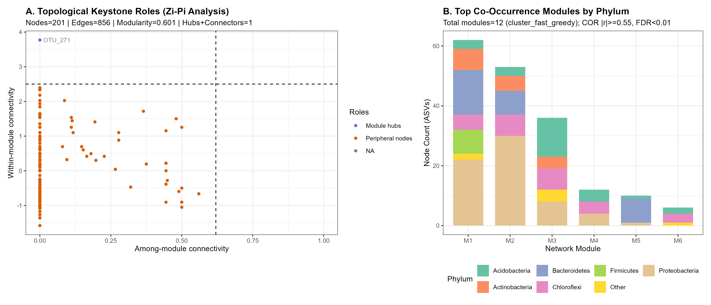
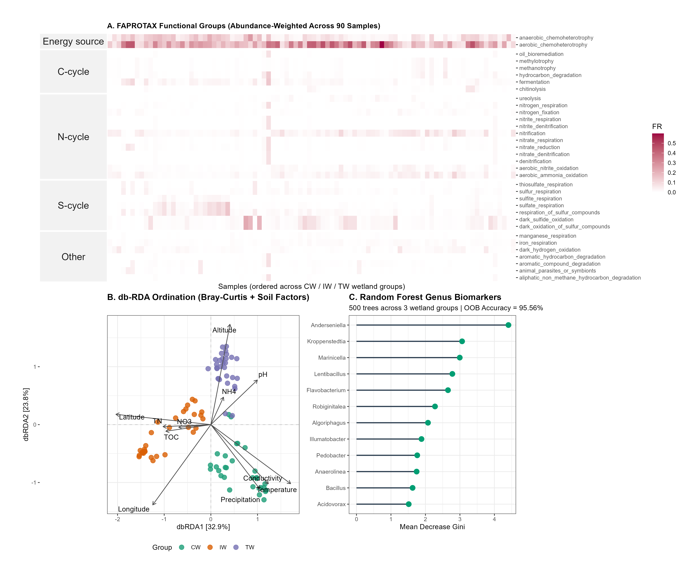

---

## 6. 一键复现与契约验收命令

在仓库根目录下执行（克隆后 `cd 16S-amplicon-reproduction`）：

```powershell
# 0. 克隆本仓库并进入根目录
git clone https://github.com/Andrew-li777/16S-amplicon-reproduction.git
cd 16S-amplicon-reproduction

# 1. R 依赖包只读体检（安装缺失 CRAN / Bioconductor 包可去掉 --dry-run）
Rscript envs/install_packages.R --dry-run

# 2. 10 秒确定性冒烟测试（验证组成性 CLR 校正 + 阴性去污 + 门禁校验）
python repro_scripts/run_all.py --mode smoke

# 3. 快速模式（复用 01_ps_miseq.rds，~66 秒完成全套下游分析与 9 项门禁校验）
python repro_scripts/run_all.py --mode quick

# 4. 端到端全量模式（含 FASTQ 自动缓存下载、DADA2 降噪建树及 14 项定量验收）
python repro_scripts/run_all.py --mode full

# 5. 单独运行全量契约校验器
python repro_scripts/verify_outputs.py --contract ground_truth_contract.json --mode full --out repro_results/verification_report.json
```

---

## 7. 工程文档索引与后续拓展方向

- **候选检索与 7 维审计**：[01_16S扩增子可复现项目与文献清单.md](./01_16S扩增子可复现项目与文献清单.md) ｜ [02_候选项目7维红灯审计.md](./02_候选项目7维红灯审计.md)
- **三级数据台账**：[data/README.md](./data/README.md) ｜ [data/raw/README.md](./data/raw/README.md) ｜ [data/processed/README.md](./data/processed/README.md)
- **技术 SOP 与排坑指南**：[REPRO_E_16S双轨复现SOP与排坑复盘.md](./docs/REPRO_E_16S双轨复现SOP与排坑复盘.md)
- **后续拓展方向**：
  1. **容器化 QIIME 2 / PICRUSt2 横向对标**：启用 [envs/Dockerfile.qiime2_optional](./envs/Dockerfile.qiime2_optional) 在 Linux Docker 中跑通 `.qza/.qzv` 与 KEGG 通路预测，并与本工作区原生 R DADA2 结果交叉核对；
  2. **三代全长 16S 种级分辨率升级**：接入 `EasyAmplicon 2` / PacBio HiFi 数据集验证种水平精确分类；
  3. **多组学联动**：将 `03` 筛选出的共识菌属及 `02` 样本主坐标轴对接 `WGCNA` 宿主转录组模块或 `mbGWAS` 孟德尔随机化研究。
