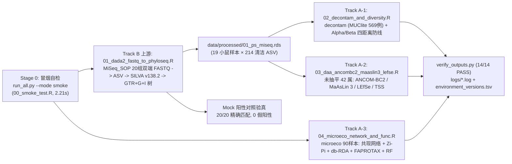

# `REPRO-E` 16S rRNA 扩增子双轨复现技术 SOP 与排坑复盘

> **文档性质**：严格遵循 `REPRO-E` 工程规范沉淀的技术复盘文档。所有参数、软件版本、日志报错与定量指标均来自本工作区 `repro_scripts/`、`logs/` 与 `repro_results/` 实测输出。

---

## 1. 项目背景与双轨架构流转

为系统性覆盖 16S rRNA 扩增子生信分析的**上游序列降噪注释**与**下游群落统计/生态网络挖掘**两大工程阵地，本工作区采用纯原生 `R 4.6.0 / Bioconductor 3.23` 双轨流水线架构（结合 `Python 3.13.3` 总控调度与 JSON 契约门禁）：

---

## 2. 核心质控阈值、统计防线与实测定量基准

### 2.1 Track B 上游关键参数依据（`01_dada2_fastq_to_phyloseq.R`）

| 处理环节 | 关键参数与设计依据 | 实测定量结果 |
|---|---|---|
| 双端质量截断 | `truncLen = c(240, 160)`、`maxN = 0`、`maxEE = c(2, 2)`、`truncQ = 2`。V4 扩增子约 `252 bp`，截断后 `240 + 160 = 400 bp`，保留约 **`148 bp` 重叠区**，兼顾 R2 末端质量衰减切除与双端高拼接率 | `19` 例小鼠样本 + `1` 例 `Mock` 共 `20` 对 FASTQ 平滑完成过滤 |
| 错误率学习与降噪 | R1 (`33,514,080` 碱基) 与 R2 (`22,342,720` 碱基) 各自独立学习非参数错误模型后执行单碱基分辨 DADA2 降噪与 `mergePairs(minOverlap = 12)` | 原始拼接序列 **`293`** 条；共识法去嵌合体后保留 **`232`** 条 ASV，全队列非嵌合读段总保留率 **`96.40%`**（各样本最终留存率 `72.65%`–`89.33%`） |
| 阳性 Mock 真值验真 | 提取 `Mock` 样本全部非嵌合 ASV（`4,269` 条 reads），逐条精确比对 `HMP_MOCK.v35.fasta` 参考序列 | 检出 **`20`** 条 ASV，**`20/20` 精确匹配**参考菌株，**假阳性 = `0`** |
| SILVA v138.2 注释与过滤 | 界–属（`toGenus`）+ 精确种匹配（`assignSpecies`）；剔除 `Mock` 后保留小鼠肠道样本中存在的 `218` 条 ASV，进一步去除未定门、叶绿体与线粒体 | `218 -> 214` 条清洁细菌 ASV（剔除 `4` 条噪声）；注释完整度：**界/门/纲/目 `100%` (`214/214`)**，**科 `91.1%` (`195/214`)**，**属 `53.7%` (`115/214`)**，**种 `4.7%` (`10/214`)**，直观印证短读长 V4 区在“属”级稳定而“种”级受限 |
| 系统发育建树与定根 | `DECIPHER::AlignSeqs` + `phangorn` NJ 初始树 + GTR+G+I 最大似然优化 + **`phangorn::midpoint()` 中点定根** | 消除无根树在 UniFrac 计算时的随机外群漂移 |

### 2.2 Track A 下游三大统计防线实测结果

1. **低生物量去污染防线（`decontam`）**：
   - 在 `MUClite`（`539` 生物样本 + `30` 阴性对照，`1,951` 特征）中以 `method = "combined", threshold = 0.10` 检出 **`56`** 个试剂盒污染 ASV，典型代表 `Seq175 (Stenotrophomonas)`、`Seq243 (Sphingomonas)`、`Seq266 (Acidovorax)`、`Seq30 (Tumebacillus)` 均呈现与样本 DNA 定量浓度的对数负相关斜率。
2. **Alpha 无差异 vs. Beta 极显著 + `betadisper` 离散度双检（`02_decontam_and_diversity.R`）**：
   - 按最小文库深度 **`2,516` reads** 抽平后，断奶早期（`Early`, `n=9`）与晚期（`Late`, `n=10`）在 Shannon 指数（`3.6923` vs `3.3598`, `p = 0.1333`）与 Faith's PD（`p = 0.3562`）上均**无显著差异**；
   - 然而 4 种 Beta 距离的 `PERMANOVA (adonis2, by = "margin")` 全部极显著分离（`p = 0.001`）：`Bray-Curtis R² = 0.4272`、`Weighted UniFrac R² = 0.3814`、`Unweighted UniFrac R² = 0.3594`、`Aitchison CLR R² = 0.3200`。
   - **关键判读**：`betadisper` 显示 Bray-Curtis (`p = 0.008`) 与 Weighted UniFrac (`p = 0.041`) 存在组内离散度不齐性（反映断奶初期个体菌群高度异质、晚期趋于收敛），而 **Unweighted UniFrac (`betadisper p = 0.905`)** 与 **Aitchison CLR (`betadisper p = 0.173`)** 满足方差齐性且 `PERMANOVA` 依然 `p = 0.001`，从统计上铁证组间确实存在真实的群落中心结构迁移。
3. **组成性差异丰度多算法交叉验证（`03_daa_ancombc2_maaslin3_lefse.R`）**：
   - 严格输入**未抽平**属水平计数表（流行率 $\ge 10\%$，共 `42` 属）：
   - 传统 `TSS Wilcoxon`（`13` 属）与 `LEfSe`（`13` 属）显著数量偏多；考虑抽样分数偏差的 **`ANCOM-BC2`（`8` 属）** 与联合检验丰度/流行率的 **`MaAsLin 3`（`6` 属）** 更加稳健保守；
   - 共得到 **`8` 个至少被 2 种现代工具共同支持的共识差异属**（`Lactobacillus`、`Turicibacter`、`Anaerotruncus` 三属获全部方法一致支持，均为晚期显著富集；`Enterocloster`、`Oscillibacter`、`Butyribacter` 为早期富集）。
4. **生态网络与多分类标志物（`04_microeco_network_and_func.R`）**：
   - 在 `microeco` `90` 样本湿地 16S 队列（`404` ASV）中构建 Spearman 共现网络（`|r| >= 0.55, FDR < 0.01`）：包含 **`201` 节点、`856` 边、`12` 个模块**，模块度 **`0.6005`**；`Zi-Pi` 拓扑识别出 `1` 个 `Module hub`（`OTU_271`, *Gaiellales*, `Zi = 3.78, Pi = 0`）。
   - `db-RDA` 解析出温度/电导率/pH/TOC 等土壤驱动梯度；`FAPROTAX v1.2.12` 映射出 `35` 项生态功能群；`500` 棵树随机森林在 `CW/IW/TW` 三组间实现 **`95.56%` 袋外分类准确率（OOB Accuracy）**（Top 标志属：`Anderseniella`、`Kroppenstedtia`、`Marinicella`、`Lentibacillus`、`Flavobacterium`）。

---

## 3. 复现过程中实测定位并解决的 7 项工程问题

| # | 阻塞现象 / 报错信息 | 根因定位 | 实际修复方案与代码位置 |
|---|---|---|---|
| **1** | Windows 下若对 `dada2::filterAndTrim()` 开启并行极易发生进程异常/卡死 | `filterAndTrim` 底层使用不兼容 Windows 的 POSIX 多进程模型，而下游 `learnErrors`/`dada`/`assignTaxonomy` 基于 `RcppParallel` 可安全多线程 | 在 [01_dada2_fastq_to_phyloseq.R](../repro_scripts/01_dada2_fastq_to_phyloseq.R#L140-L145) 强制设置 `multithread = !IS_WINDOWS` |
| **2** | `phangorn::optim.pml(..., rearrangement = "stochastic")` 在 `214` 条 ASV 上单核运行超 `1,000 CPU 秒` 仍未退出 | `phangorn 2.12.1` 默认随机棘轮搜索在 >200 枝端序列上搜索空间呈组合爆炸 | 切换为确定性 `rearrangement = "NNI"` 并配合 `phangorn::midpoint()` 定根（[01_dada2_fastq_to_phyloseq.R](../repro_scripts/01_dada2_fastq_to_phyloseq.R#L291-L296)），兼顾似然优化与分钟级交付 |
| **3** | `03` 首次运行 `ANCOMBC::ancombc2` 报错：`The 'microbiome' package is needed to process the imported data` | `ANCOMBC 2.14.0` 仅将 `microbiome` 列在 `Suggests` 中，但接收 `phyloseq` 对象时内部强校验该包 | 在 [install_packages.R](../envs/install_packages.R#L33-L37) 中增补 `"microbiome"` 至 `bioc_core` 并安装 `microbiome 1.34.0` |
| **4** | `microeco 2.4.3` 探针中 `cal_spe_func` 报弃用，且 `tn$get_node_table()` 直接索引报 `environment is not subsettable` | `microeco >= 1.15.1` 将 `cal_spe_func`/`cal_spe_func_perc` 重命名为 `cal_func`/`cal_func_FR`；R6 方法返回 `self` 并将结果表写入 `object$res_node_table` | 在 [04_microeco_network_and_func.R](../repro_scripts/04_microeco_network_and_func.R#L70-L120) 全部迁移至现代 R6 字段读写规范 |
| **5** | `04` 初版图 `C` 随机森林特征标签出现 `.10`、`.11`、`.18`、`.45` 等异常序号 | 未命名属 `g__` 在提取前缀后变为空串 `""`，先执行 `make.unique()` 将空白串编号，再做正则过滤导致残留数字后缀 | 调整顺序：先过滤空白与 `unclassified`/`Incertae_Sedis` 再用 `rowsum()` 合并同名属，彻底消除无效标签（[04_microeco_network_and_func.R](../repro_scripts/04_microeco_network_and_func.R#L136-L144)） |
| **6** | `03` 初版漏绘 `Butyribacter` 与 `Clostridium` 两个高共识属，且 `ggplot2 4.0.3` 对 `geom_errorbarh()` 报弃用 | 二者因存在结构零或高稀疏度被 `ANCOM-BC2` 内部剔除导致 `ANCOMBC2_LFC` 为 `NA`，原代码过滤 `!is.na(ANCOMBC2_LFC)` 误删整行 | 按 `N_Modern_Calls` 联合 `MaAsLin3_Coef` 排序保留全部 8 个共识属，在右图对 `ANCOM-BC2` 过滤行标注斜体提示并迁移为 `geom_errorbar(orientation = "y")`（[03_daa_ancombc2_maaslin3_lefse.R](../repro_scripts/03_daa_ancombc2_maaslin3_lefse.R#L212-L254)） |
| **7** | `00` 初版冒烟图 Panel A 左上方统计文本框与蓝色散点轻微重叠 | 文本锚点 `x = -0.35` 靠近右侧真阳性散点 | 移至左上空白区 `x = -2.95, y = 2.75` 并重跑 `--mode smoke` 复核零遮挡（[00_smoke_test.R](../repro_scripts/00_smoke_test.R#L222-L227)） |

---

## 4. 生产复用指南：如何接入新一批真实 16S FASTQ 样本

若需将本工作区流水线迁移至新项目（如人肠道/土壤 V3–V4 队列），只需遵循以下契约改动：

1. **前置引物切除（V3–V4 等含简并引物建库必做）**：本教学数据 `MiSeq_SOP` 已由测序中心预先切除 PCR 引物；真实下机原始 FASTQ 在进入 `filterAndTrim()` 前**必须先调用 `cutadapt`** 切除正反向引物，否则 DADA2 会将引物简并碱基误判为多态性并导致嵌合体去除异常偏高。
2. **重测质量截断与重叠区**：在 `config.yaml` 中调整 `trunc_len_f` / `trunc_len_r`，确保满足：
   $$\text{trunc\_len\_f} + \text{trunc\_len\_r} - \text{Amplicon\_Length} \ge 20\text{ bp}$$
3. **阴性对照与协变量接入**：在样本元数据表保留 `Sample_or_Control` 与 DNA 提取浓度（供 `decontam` 自动识别试剂盒污染），并在 [03_daa_ancombc2_maaslin3_lefse.R](../repro_scripts/03_daa_ancombc2_maaslin3_lefse.R) 的 `fix_formula`（`ANCOM-BC2`）与 `fixed_effects`（`MaAsLin 3`）中同时传入 `Batch`、年龄、用药等临床协变量。
